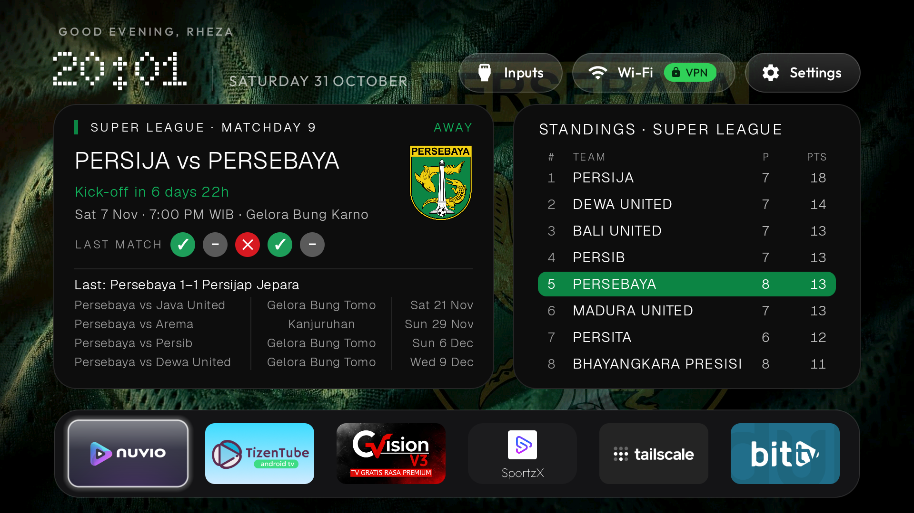

# Football TV Launcher — a CleanYourTV-style fork

A Nothing-inspired home screen for Android TV / Google TV: black, quiet,
dot-matrix type, and a football card for the club you follow. Built in the
spirit of [CleanYourTV](https://github.com/Gathin23/cleanyourtv) — debloat
with ADB, disable instead of uninstall, and run a small launcher that
stays out of the way.

This repository contains two apps:

| App | What it does |
| --- | --- |
| `launcher/` | The home screen itself. **No INTERNET permission** — it never goes online. |
| `live-feed/` | An optional 25 KB add-on, the only app with internet access. Every 6 hours it refreshes the football cards (fixtures, results, standings) and hands the data to the launcher through a content provider. Without it, the launcher simply shows its built-in snapshot. |

## Screenshot



*The Persebaya theme on the reference TV (TCL T6C, Google TV): greeting and
dot-matrix clock, the club card with next-match countdown, recent form and
the fixture list, and the standings card below.*

## Features

- Nothing-style header: time-aware greeting, dot-matrix (Doto) clock, date,
  and quiet Inputs / Wi-Fi / Settings pills. English UI.
- App dock + full app library, remote-first navigation, subtle synthesized
  navigation sounds.
- **Six switchable club themes** (long-press Settings → "Theme: …" cycles
  them; each switch changes the card data, crest, accent colours and the
  ghost-crest wallpaper together):
  1. Persebaya — Indonesian Super League
  2. Como 1907 — Serie A
  3. Manchester United — Premier League
  4. Arsenal — Premier League
  5. Liverpool — Premier League
  6. Barcelona — La Liga
- Club card: next match with a live countdown, last result, last-five form
  dots, the next four fixtures, and a standings card with your club's row
  highlighted in club colours. (If the club sits outside the top 8, the
  card shows positions 1–7 and then the club's own position.)
- A Home-button helper for firmware (looking at you, TCL Google TV) where
  the stock launcher keeps reclaiming the Home key even after you pick a
  different default — see `docs/INSTALL.md`. The stock launcher is never
  disabled, so going back is always possible.

## Live data

The add-on reads ESPN's free public JSON API (no account, no API key) and
publishes `livedata.json`; the launcher overlays it on its snapshot field
by field, so a feed problem can never break the home screen — it just
falls back to the snapshot.

Known gap: ESPN does not carry the Indonesian Super League 2026-27 season
yet (it still serves the finished 2025-26 season), so the Persebaya theme
currently stays on its snapshot. The add-on re-checks every refresh and
will pick the season up automatically if ESPN opens it. The other five
themes are fully live.

## Building

Normal route — Gradle (Android Studio, or Gradle 8.9+ with JDK 17):

```sh
cd launcher && gradle assembleDebug      # the home screen
cd live-feed && gradle assembleDebug     # the add-on
```

Both apps are signed with the debug key in their build files, so a rebuild
installs cleanly over a previous sideload.

Alternative route — `tools/` holds the exact manual pipeline
(aapt2 → javac → d8 → zipalign → apksigner, no Gradle) used to produce the
reference builds in an environment where Gradle's workers cannot run.
It needs a local file-Maven mirror of the launcher's dependencies;
`tools/prefetch_maven.py` creates one, and `LOCAL_MAVEN` points the
scripts at it.

## Installing

See **[docs/INSTALL.md](docs/INSTALL.md)** — ADB install, making the
launcher your home (including the TCL helper setup and the one thing you
must *not* do), arming the add-on, and how to roll everything back.

## Credits

- Base launcher: [yashraut362/nothing-tv-launcher-CleanYourTV](https://github.com/yashraut362/nothing-tv-launcher-CleanYourTV) (MIT) — this repo is a heavily restyled fork of it.
- Method and debloat philosophy: [Gathin23/cleanyourtv](https://github.com/Gathin23/cleanyourtv) (MIT).
- Football data: ESPN's public API. Standings/fixtures snapshots bundled
  in the launcher were compiled from public sources on 31 Oct 2026.

Club names and crests are trademarks of their respective clubs; they are
included for personal, non-commercial use. The ghost wallpapers are
AI-generated fabric textures with the crest composited as a watermark.

## License

MIT — see [LICENSE](LICENSE) and [NOTICE.md](NOTICE.md).
